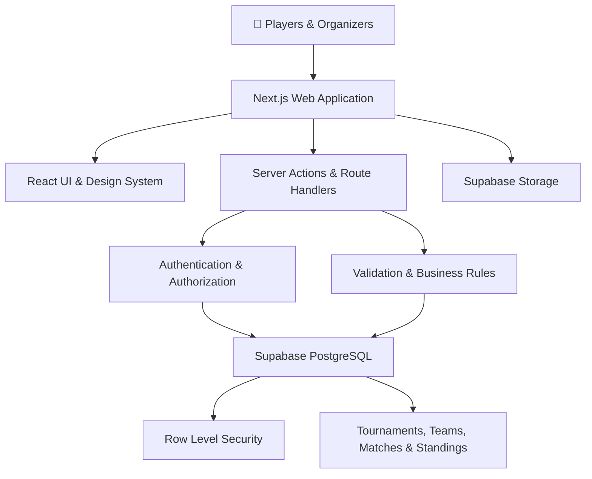

 
<div align="center">

# 🏆 SPORT ORGANIZER

### Your Game. Your Team. Your Tournament.

**A modern sports tournament management platform built to bring players, teams, organizers, and competitions together in one place.**

[](https://github.com/YOUR_GITHUB_USERNAME/sport-organizer)
[](https://nextjs.org/)
[](https://www.typescriptlang.org/)
[](https://supabase.com/)

<br/>

**Discover competitions. Build your team. Compete for glory.**

[🚀 Get Started](#-getting-started) · [✨ Features](#-features) · [📚 Documentation](#-project-documentation) · [🗺️ Roadmap](#️-project-roadmap)

<br/>

</div>

---

## ⚡ The Vision

Sports tournaments often rely on scattered spreadsheets, manual registrations, group chats, and confusing score updates.

**Sport Organizer aims to bring the entire tournament experience into one organized platform.**

Whether you're a player looking for your next competition, a captain managing a team, or an organizer running a tournament, Sport Organizer is designed to make every step simpler.

> 🎯 **Our mission:** Make sports tournament management accessible, organized, transparent, and enjoyable.

---

## ✨ Features

<table>
<tr>
<td width="50%">

### 🏟️ Tournament Discovery
- Explore available tournaments.
- View tournament details and rules.
- Discover competitions by sport.
- Track registration availability.

</td>
<td width="50%">

### 👥 Team Management
- Create and manage teams.
- Organize team members.
- Manage team information.
- Support team-captain workflows.

</td>
</tr>
<tr>
<td width="50%">

### 📝 Smart Registration
- Register teams for tournaments.
- Track pending and approved applications.
- Prevent duplicate active registrations.
- Enforce tournament capacity rules.

</td>
<td width="50%">

### 🗓️ Matches & Results
- Organize match schedules.
- Publish match results.
- Display match status and scores.
- Maintain competition records.

</td>
</tr>
<tr>
<td width="50%">

### 📊 Standings & Rankings
- View tournament standings.
- Track wins, losses, and points.
- Present competition progress.
- Keep rankings consistent with recorded results.

</td>
<td width="50%">

### 🔔 Notifications & Updates
- Receive important updates.
- View tournament announcements.
- Track registration and match changes.
- Stay informed about competitions.

</td>
</tr>
</table>

### 🛡️ Built with security in mind

- Role-based access control.
- Supabase authentication.
- PostgreSQL Row Level Security (RLS).
- Server-side validation and authorization.
- Secure handling of environment variables.
- Audit logging for important administrative actions.

*Features are planned and implemented incrementally. The checklist below reflects the intended product scope, not a claim that every feature is already live.*

---

## 🧑‍🤝‍🧑 Designed for Every Role

| Role | What they can do |
|---|---|
| 🌐 Visitor | Discover tournaments and explore public information |
| 🧑 Player | Manage a profile and participate through a team |
| 🧢 Team Captain | Manage a team and submit tournament registrations |
| 🏆 Tournament Organizer | Create tournaments, manage registrations, schedule matches, and publish results |
| 🏢 Organization Admin | Manage organization members and authorized activities |
| 🛡️ Platform Admin | Oversee platform operations and administrative workflows |

Permissions will be enforced on the server and through database policies—not just by hiding buttons in the interface.

---

## 🎨 Product Experience

Sport Organizer is being designed as a clean, responsive sports SaaS application.

- **Modern interface:** A consistent design system with reusable components.
- **Responsive layouts:** Usable across desktop, tablet, and mobile screens.
- **Clear navigation:** Dedicated experiences for discovery, teams, tournaments, and dashboards.
- **Useful feedback:** Loading states, empty states, validation messages, and error recovery.
- **Accessible design:** Keyboard-friendly interactions and readable color contrast.
- **Performance-conscious:** Server rendering where appropriate, pagination, and efficient database queries.

### Design direction

| Design element | Choice |
|---|---|
| Primary color | `#2563EB` — Electric Blue |
| Dark color | `#0F172A` — Deep Navy |
| Background | `#F8FAFC` — Soft Slate |
| Surface | `#FFFFFF` — White |
| Typography | Inter |
| UI style | Modern, minimal, sports-focused SaaS |

---

## 🧰 Tech Stack

<div align="center">

[](https://nextjs.org/)
[](https://react.dev/)
[](https://www.typescriptlang.org/)
[](https://tailwindcss.com/)
[](https://supabase.com/)
[](https://vercel.com/)

</div>

| Technology | Purpose |
|---|---|
| **Next.js App Router** | Full-stack web framework and routing |
| **React** | Component-based user interface |
| **TypeScript** | Type safety and maintainability |
| **Tailwind CSS** | Responsive styling |
| **shadcn/ui** | Reusable and customizable UI components |
| **Lucide React** | Consistent icons |
| **Supabase Auth** | Authentication and session management |
| **Supabase PostgreSQL** | Relational data storage |
| **Supabase Storage** | File and image storage |
| **React Hook Form + Zod** | Form state and schema validation |
| **Vitest + React Testing Library** | Unit and component testing |
| **Playwright** | End-to-end testing |
| **GitHub** | Source control and collaboration |
| **Vercel** | Application hosting and deployment |

---

## 🏗️ Architecture at a Glance



The application follows a feature-oriented architecture, with clear boundaries between the UI, server-side operations, validation, authentication, and database access.

**Core principle:** Critical business rules must be enforced on the server and in the database wherever appropriate.

---

## 🚀 Getting Started

### Prerequisites

Before setting up the project, make sure you have:

- [Node.js](https://nodejs.org/) — an active LTS release.
- npm — included with Node.js.
- [Git](https://git-scm.com/).
- A [Supabase](https://supabase.com/) project.
- A code editor such as [Visual Studio Code](https://code.visualstudio.com/).

### 1. Clone the repository

```bash
git clone https://github.com/YOUR_GITHUB_USERNAME/sport-organizer.git
cd sport-organizer
```

> Replace the repository URL with your actual GitHub repository URL if its name differs.

### 2. Install dependencies

```bash
npm install
```

### 3. Configure environment variables

Create a `.env.local` file in the project root:

```env
NEXT_PUBLIC_SUPABASE_URL=your_supabase_project_url
NEXT_PUBLIC_SUPABASE_PUBLISHABLE_KEY=your_supabase_publishable_key
```

Add the values from your Supabase project's API settings.

If the application requires privileged server-side operations, configure any server-only secret variables documented by the project. Never expose a secret key in client-side code or commit real credentials to GitHub.

See [`docs/16-ENVIRONMENT-VARIABLES.md`](docs/16-ENVIRONMENT-VARIABLES.md) for the complete configuration guide.

### 4. Prepare the database

1. Create or open your Supabase project.
2. Apply the project's SQL migrations in the documented order.
3. Configure Row Level Security policies.
4. Set up the required authentication and storage settings.
5. Apply development seed data if available.

Follow [`docs/04-DATABASE-SCHEMA.md`](docs/04-DATABASE-SCHEMA.md) and [`docs/05-AUTHENTICATION-AND-AUTHORIZATION.md`](docs/05-AUTHENTICATION-AND-AUTHORIZATION.md).

### 5. Start the development server

```bash
npm run dev
```

Open [http://localhost:3000](http://localhost:3000) in your browser.

### 6. Run checks

Use the scripts defined in `package.json`. If configured, the standard checks may include:

```bash
npm run lint
npm run typecheck
npm run test
npm run build
```

For end-to-end tests, use the project's configured Playwright script.

*These commands must exist in `package.json` before they can be run successfully. Check the available scripts and the testing documentation if any command is missing.*

---

## 📚 Project Documentation

Sport Organizer includes a structured documentation set so developers and AI coding tools can understand the project before making changes.

<details>
<summary><strong>📖 View all 19 documentation files</strong></summary>

<br/>

| # | Document | Purpose |
|---:|---|---|
| 01 | [Project Overview](docs/01-PROJECT-OVERVIEW.md) | Product vision, goals, scope, and core principles |
| 02 | [Product Requirements Document](docs/02-PRD.md) | Functional requirements and acceptance criteria |
| 03 | [Technology Stack](docs/03-TECH-STACK.md) | Frameworks, libraries, and architecture choices |
| 04 | [Database Schema](docs/04-DATABASE-SCHEMA.md) | Tables, relationships, constraints, and indexes |
| 05 | [Authentication & Authorization](docs/05-AUTHENTICATION-AND-AUTHORIZATION.md) | Identity, roles, permissions, and access rules |
| 06 | [UI/UX Guidelines](docs/06-UI-UX-GUIDELINES.md) | User experience, accessibility, and responsive design |
| 07 | [Color & Typography](docs/07-COLOR-TYPOGRAPHY.md) | Brand palette, typography, and visual tokens |
| 08 | [Design System](docs/08-DESIGN-SYSTEM.md) | Shared UI components and reusable patterns |
| 09 | [Features & Modules](docs/09-FEATURES-AND-MODULES.md) | Product modules and their dependencies |
| 10 | [API & Backend](docs/10-API-AND-BACKEND.md) | Server operations, data access, and business logic |
| 11 | [Security Rules](docs/11-SECURITY-RULES.md) | Security practices and threat prevention |
| 12 | [User Flows](docs/12-USER-FLOWS.md) | User journeys and interaction flows |
| 13 | [Validation & Error Handling](docs/13-VALIDATION-AND-ERROR-HANDLING.md) | Input validation and error conventions |
| 14 | [Testing Strategy](docs/14-TESTING-STRATEGY.md) | Unit, integration, and end-to-end testing |
| 15 | [Deployment Guide](docs/15-DEPLOYMENT-GUIDE.md) | Production setup and deployment process |
| 16 | [Environment Variables](docs/16-ENVIRONMENT-VARIABLES.md) | Local configuration and secret management |
| 17 | [Coding Standards](docs/17-CODING-STANDARDS.md) | Code quality, conventions, and review rules |
| 18 | [Implementation Roadmap](docs/18-IMPLEMENTATION-ROADMAP.md) | Phases, priorities, and completion criteria |
| 19 | [AI Coding Instructions](docs/19-AI-CODING-INSTRUCTIONS.md) | Master guidance for AI-assisted implementation |

</details>

### 📌 Where should you start?

- **New developer?** Start with `01-PROJECT-OVERVIEW.md`.
- **Planning features?** Read `02-PRD.md` and `09-FEATURES-AND-MODULES.md`.
- **Building the UI?** Read `06-UI-UX-GUIDELINES.md`, `07-COLOR-TYPOGRAPHY.md`, and `08-DESIGN-SYSTEM.md`.
- **Working on the backend?** Read `04-DATABASE-SCHEMA.md`, `05-AUTHENTICATION-AND-AUTHORIZATION.md`, and `10-API-AND-BACKEND.md`.
- **Using an AI coding agent?** Start with `19-AI-CODING-INSTRUCTIONS.md` and follow the implementation roadmap.

---

## 🗺️ Project Roadmap

The roadmap below describes the intended development sequence.

- [ ] **Phase 1 — Foundation:** Next.js setup, TypeScript, Tailwind CSS, linting, and repository structure.
- [ ] **Phase 2 — Database:** Supabase configuration, migrations, schema, indexes, and RLS policies.
- [ ] **Phase 3 — Design System:** Colors, typography, reusable components, and responsive application shell.
- [ ] **Phase 4 — Authentication:** Registration, login, verification, password recovery, and protected routes.
- [ ] **Phase 5 — Profiles & Organizations:** User profiles, organization setup, and member roles.
- [ ] **Phase 6 — Team Management:** Team creation, member management, and captain workflows.
- [ ] **Phase 7 — Tournament Management:** Discovery, tournament details, creation, and publishing.
- [ ] **Phase 8 — Registrations:** Team applications, approvals, capacity limits, and duplicate prevention.
- [ ] **Phase 9 — Matches & Results:** Scheduling, score entry, result publication, and match history.
- [ ] **Phase 10 — Standings:** Rankings, points, and standings updates.
- [ ] **Phase 11 — Announcements & Administration:** Notifications, audit logs, and admin workflows.
- [ ] **Phase 12 — Quality Assurance:** Automated tests, security checks, accessibility, and performance.
- [ ] **Phase 13 — Deployment:** Production environment, domain configuration, monitoring, and release checks.

> The roadmap checkboxes are a planning template. Update them as milestones are completed; they do not represent verified implementation status.

---

## 🧪 Quality & Security

The project aims to follow these principles:

- [x] Documented architecture and implementation plan.
- [x] Defined technology stack and design direction.
- [x] Documented role and permission requirements.
- [ ] Automated tests for critical business rules.
- [ ] Verified Row Level Security policies.
- [ ] Tested registration capacity and duplicate prevention.
- [ ] Tested score updates and standings consistency.
- [ ] Validated production configuration and deployment.
- [ ] Completed accessibility and performance checks.

The checked items indicate documentation prepared for the project, not necessarily a fully implemented or production-verified application.

---

## 🤝 Contributing

Contributions, suggestions, bug reports, and improvements are welcome.

1. Fork the repository.
2. Create a feature branch:

   ```bash
   git checkout -b feat/your-feature
   ```

3. Follow the project's coding standards.
4. Add or update tests for your changes.
5. Run the relevant quality checks.
6. Commit your changes:

   ```bash
   git commit -m "feat: describe your change"
   ```

7. Push the branch and open a Pull Request.

For substantial changes, review the relevant documentation before modifying the application.

---

## 🔐 Security

If you discover a security vulnerability, please avoid publishing sensitive exploit details in a public issue. Contact the repository maintainer privately when a private reporting method is available.

**Never commit:**

- `.env.local` or other files containing real credentials.
- Supabase secret keys.
- Database passwords.
- Private user information or production data.

See [`docs/11-SECURITY-RULES.md`](docs/11-SECURITY-RULES.md).

---

## 📌 Current Project Status

**Development stage:** Documentation and phased implementation planning.

The repository's actual implementation status should be updated as features are built, tested, and verified.

| Area | Status |
|---|---|
| Product requirements | Documented |
| Technology stack | Defined |
| Database design | Documented |
| UI/UX system | Specified |
| Security approach | Documented |
| Implementation | Follow roadmap |
| Production readiness | Not yet claimed |

---

## 🌟 Why Sport Organizer?

Because organizing a tournament should be about the game—not endless spreadsheets, scattered messages, and manual score tracking.

**One platform. Connected teams. Organized competitions.**

If you find this project interesting, consider starring the repository ⭐ and following its development.

<div align="center">

### 🏆 LET THE GAMES BEGIN

**Built with passion for better sports experiences.**

<sub>Sport Organizer · A sports tournament management platform</sub>

<br/>

## 👨‍💻 Meet the Developers

<div align="center">

**The people behind Sport Organizer.** 🚀

<table>
<tr>
<td align="center" width="250">
<a href="https://github.com/Atharvpote14">

</a>
<br/>
<strong>Atharv Pote</strong>
<br/>
<a href="https://github.com/Atharvpote14">@AtharvPote14</a>
<br/><br/>
<a href="https://github.com/Atharvpote14">

</a>
</td>

<td align="center" width="250">
<a href="https://github.com/Sagar22-c">

</a>
<br/>
<strong>Sagar Pawar</strong>
<br/>
<a href="https://github.com/Sagar22-c">@SagarPawar</a>
<br/><br/>
<a href="https://github.com/Sagar22-c">

</a>
</td>

<td align="center" width="250">
<a href="https://github.com/adityasanap2709-cyber">

</a>
<br/>
<strong>Aditya Sanap</strong>
<br/>
<a href="https://github.com/adityasanap2709-cyber">@AdityaSanap</a>
<br/><br/>
<a href="https://github.com/adityasanap2709-cyber">

</a>
</td>

<td align="center" width="250">
<a href="https://github.com/Soham456-hash">

</a>
<br/>
<strong>Soham Gaikwad</strong>
<br/>
<a href="https://github.com/Soham456-hash">@SohamGaikwad</a>
<br/><br/>
<a href="https://github.com/Soham456-hash">

</a>
</td>

</tr>
</table>

*Made with ❤️, teamwork, and a passion for technology.*

</div>


[⬆ Back to Top](#-sport-organizer)

</div>
